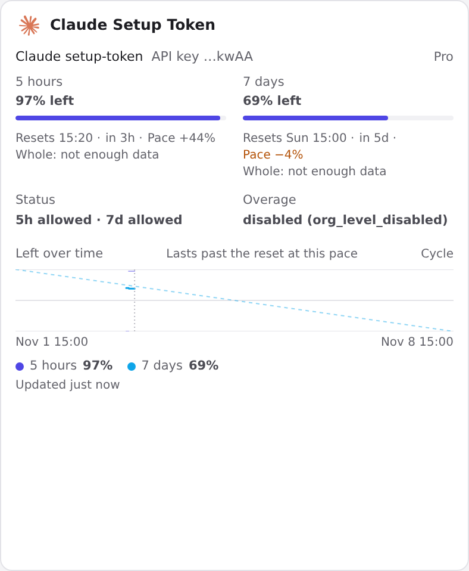

# magpie-claude-setup-token-quota

> A quota-only magpie provider that shows a Claude Pro **setup-token** account's
> 5-hour and 7-day allowance on magpie's Usage page.
>
> 一个只做额度展示的 magpie provider：把 Claude Pro setup-token 账号的 5h / 7d
> 额度显示在 magpie 的 Usage 页面。




## 背景

magpie 的内置 Claude 账号卡片依赖 Claude Code 自己的 `/usage` 来读取套餐额度。
但 `claude setup-token` 生成的长期 token 只有：

```text
scope = user:inference
```

它不能调用 `/api/oauth/usage`：

```text
403 permission_error: OAuth token does not meet scope requirement user:profile
```

因此 magpie 内置卡片的 setup-token 账号通常只能显示：

```text
unknown: a setup-token can't read the allowance
```

或者只显示某次 `rate_limit_event` 带回来的 5h，7d 不完整。

## 解决的场景

Anthropic 的 `POST /v1/messages` 响应头里其实带有完整的统一额度：

```text
anthropic-ratelimit-unified-5h-utilization
anthropic-ratelimit-unified-5h-reset
anthropic-ratelimit-unified-5h-status
anthropic-ratelimit-unified-7d-utilization
anthropic-ratelimit-unified-7d-reset
anthropic-ratelimit-unified-7d-status
anthropic-ratelimit-unified-overage-status
...
```

这个插件做的就是：

1. 用 setup-token 发一个 **1-token Haiku 请求**
2. 从响应头读取 5h / 7d / status / overage
3. 作为一个独立的 **Claude Setup Token** provider 卡片显示在 Usage 页面
4. 5 分钟内复用缓存，避免频繁探针

它不依赖 Claude OAuth 登录，不需要 refresh token，也不写 magpie 的
`quotas.json`。

## 截图

### Usage 卡片


显示：

- 5h / 7d 剩余百分比和重置时间
- 5h / 7d 状态
- Overage 状态
- Claude 图标
- magpie 自动计算的 Pace / Cycle / Left over time

### Providers 行


这个 provider：

- 只登录 setup-token
- **0 个模型**
- 不参与任何模型路由
- 只提供额度卡片

## 工作原理

插件里的鉴权是 `type: "api"`，不是 Claude OAuth：

```text
provider: claude-setup-token
method:   Claude setup-token
```

`auth.usage` 运行：

```text
POST https://api.anthropic.com/v1/messages
Authorization: Bearer <setup-token>
anthropic-version: 2023-06-01
anthropic-beta: oauth-2025-04-20
user-agent: claude-cli/2.1.317 (external, cli)

model: claude-haiku-5-5
max_tokens: 1
system: You are Claude Code, Anthropic's official CLI for Claude.
```

然后读取 `anthropic-ratelimit-unified-*` 响应头并返回给 magpie。

## 安装

### 从 GitHub 安装

```bash
magpie plugin add github:tiezbro/magpie-claude-setup-token-quota
magpie plugin login claude-setup-token
# 粘贴 claude setup-token 打印的 token
```

### 从本地目录安装

```bash
magpie plugin add /path/to/magpie-claude-setup-token-quota
magpie plugin login claude-setup-token
```

## 使用

安装并登录后：

```bash
magpie plugin list
magpie quota
magpie accounts
```

Usage 页面会出现一张独立的 **Claude Setup Token** 卡片。

这个 provider 没有模型，所以不会出现在模型选择器，也不会接收 Claude Code /
agent 的模型请求。唯一访问它账号的请求是额度探针：

```text
claude-haiku-5-5 · max_tokens 1 · 每 5 分钟最多一次
```

## 与内置 Claude 卡片的关系

- 内置 Claude 卡片：magpie 自己的账号，负责官方模型请求
- 本插件卡片：独立的额度展示 provider
- 插件**不会**修改内置卡片，也**不能**隐藏内置卡片
- 如果需要内置卡片本身显示完整 7d，只能改 magpie 本体或写它的内部缓存

## 限制

- 只有统一 5h / 7d 窗口
- 不包含 Opus / Sonnet 独立 7d 窗口
- 不包含 extra usage / credits 明细
- 读不到邮箱和套餐名
- 探针会消耗极小的订阅额度
- 需要有效的 setup-token；token 失效后需要重新执行 `claude setup-token`
  并重新登录插件

## 安全

- setup-token 保存在 magpie 的 `plugin-auth.json`，权限 `0600`
- 仓库和 npm 包中不包含任何 token
- 不要把 `plugin-auth.json`、`logins.json` 或浏览器里的 token 发到公开仓库
- 如果 token 轮换，内置 Claude 账号和本插件都需要更新

## 开发

- 运行时：magpie 的 Bun 插件宿主
- 源码：`index.mjs`
- 图标：`package.json` 的 `magpie.icon`（内嵌 Claude SVG）
- 无需构建步骤

## License

MIT
