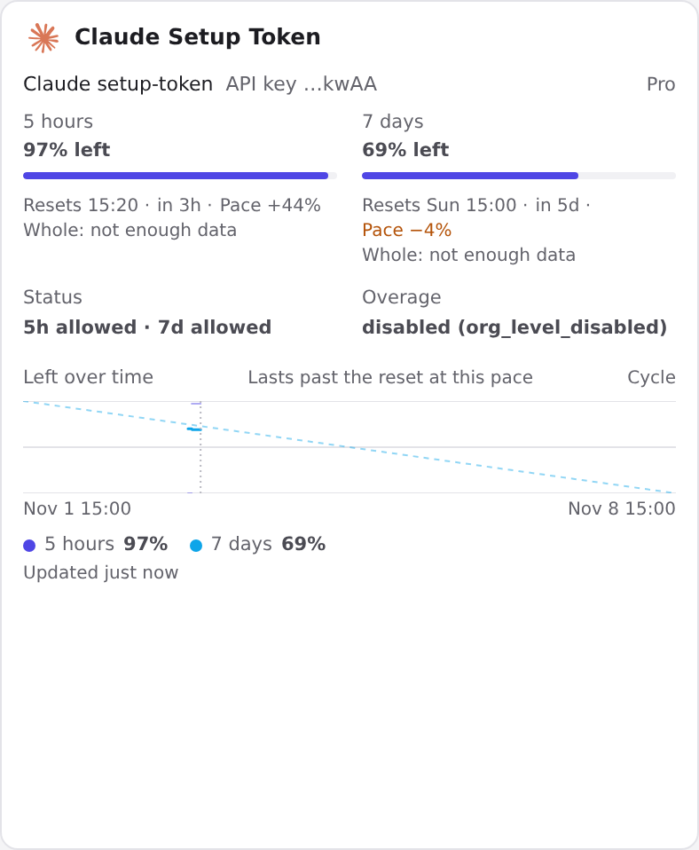

# magpie-claude-setup-token-quota

面向 Claude Pro setup-token 账号的 Magpie 额度展示插件

[](./LICENSE)
[](./package.json)
[](https://github.com/yetone/magpie)
[](https://code.claude.com/docs/en/authentication)

[English](./README.md) | [中文](./README.zh-CN.md) | [Releases](https://github.com/tiezbro/magpie-claude-setup-token-quota/releases)

> **本仓库是一个 Magpie 插件。** 它不是 Magpie 的分支，也不修改 Magpie 本体。
> 它为 Claude Pro setup-token 账号增加一张独立的、只读的额度卡片。



Magpie 内置的 Claude 卡片继续负责官方 Claude 模型请求。这个插件**不会替换**
内置卡片，而是增加第二张卡片，只回答一个问题：**这个 setup-token 账号的
5 小时额度和 7 天额度还剩多少？**

| | Magpie 内置 Claude 卡片 | 本 Magpie 插件 |
| --- | --- | --- |
| 用途 | 官方 Claude 模型请求 | 只展示额度 |
| 数据来源 | Claude Code `/usage` 或 `rate_limit_event` | `anthropic-ratelimit-unified-*` 响应头 |
| setup-token 支持 | 通常为未知，或只有不完整的 5h 数据 | 5h 和 7d |
| 登录方式 | Magpie 保存的 Claude 账号 | `magpie plugin login claude-setup-token`（粘贴 token） |
| 模型 | 官方 Claude 模型 | **0 个模型** |
| 路由 | 承接 Claude 请求 | 永远不接收模型请求 |
| 修改 Magpie 本体 | — | 无 |
| 能否隐藏内置卡片 | — | 不能；这是独立卡片 |

<!-- readme:positioning -->
## 这是什么

`magpie-claude-setup-token-quota` 是一个运行在 **Magpie 插件宿主**里的
小型 **Magpie provider 插件**。它不实现 Claude 推理，也不代理模型请求。

它会：

- 增加一个名为 **Claude Setup Token** 的 provider；
- 使用 `claude setup-token` 生成的 token，通过 Magpie 的插件鉴权登录；
- 只发送一个 Claude Code 形状的最小 Anthropic 请求来读取额度；
- **不暴露任何模型**，因此 Magpie 不会把 agent 流量路由给它；
- 不修改 Magpie 内置 Claude 账号、`logins.json` 或 `quotas.json`。

它**不是** Magpie 官方插件，也**不是** Anthropic 官方产品。它是由社区维护的
插件，读取的是 Anthropic 未公开文档化的 `anthropic-ratelimit-unified-*`
响应头。

> 社区维护项目。不是 Magpie 官方支持，也不是 Anthropic 官方支持。

<!-- readme:value -->
## 为什么需要它

Claude Pro 订阅可以通过下面的命令生成长期 token：

```bash
claude setup-token
```

这个 token 只有推理权限：

```text
user:inference
```

因此 Anthropic 的专用额度接口会拒绝它：

```text
GET /api/oauth/usage
403 permission_error: OAuth token does not meet scope requirement user:profile
```

Magpie 内置 Claude 卡片的数字来自 Claude Code 自己的 `/usage`（或
`rate_limit_event`）。对 setup-token 账号来说，这会让卡片停留在 `unknown`，
或者只有一个不完整的 5h 读数；但正常的模型响应其实已经在响应头里带了完整的
统一额度：

```text
anthropic-ratelimit-unified-5h-utilization
anthropic-ratelimit-unified-5h-reset
anthropic-ratelimit-unified-5h-status
anthropic-ratelimit-unified-7d-utilization
anthropic-ratelimit-unified-7d-reset
anthropic-ratelimit-unified-7d-status
anthropic-ratelimit-unified-overage-status
```

这个插件读取这些响应头，并把它们转换成 Magpie 的额度卡片。

<!-- readme:architecture -->
## 工作原理

```text
Magpie
  -> provider 插件 claude-setup-token
       auth:   type "api"，setup-token 保存在 plugin-auth.json（0600）
       usage:  发送一个最小的 Anthropic 请求
                 model: claude-haiku-5-5
                 max_tokens: 1
                 Authorization: Bearer <setup-token>
                 anthropic-beta: oauth-2025-04-20
               读取 anthropic-ratelimit-unified-* 响应头
               返回 5h / 7d 窗口 + status / overage
  -> Magpie Usage 页面
       一张卡片：Claude Setup Token
```

探测结果缓存 5 分钟。这个卡片不是模型 provider：它注册 0 个模型，不进入任何
路由组，也不会接收 Claude Code 或 agent 请求。唯一到达 setup-token 账号的请求，
就是这个小额度探测请求。

插件不会：

- 使用 Claude Code OAuth 登录；
- 读取或写入 `~/.claude/.credentials.json`；
- 刷新 token；
- 写入 `quotas.json`；
- 修改 Magpie 内置 Claude 卡片。

<!-- readme:requirements -->
## 环境要求

- 支持 provider 插件的 Magpie（在 Linux 上使用 Magpie **0.1.2798** 测试）
- 可以运行 `claude setup-token` 的 Claude 订阅
- Magpie 宿主机可以访问 `api.anthropic.com`
- setup-token 本身；安装后不需要再打开浏览器登录

## 快速开始

### 1. 安装插件

```bash
magpie plugin add github:tiezbro/magpie-claude-setup-token-quota
```

或者安装本地目录：

```bash
magpie plugin add /path/to/magpie-claude-setup-token-quota
```

### 2. 用 setup-token 登录插件

```bash
claude setup-token
magpie plugin login claude-setup-token
# 粘贴 claude setup-token 输出的 token
```

Magpie 会把 token 保存在权限为 `0600` 的 `plugin-auth.json` 中。

### 3. 打开 Usage 页面

```bash
magpie plugin list
magpie quota
magpie accounts
```

打开 Magpie 的 **Usage** 页面。会看到一张独立的 **Claude Setup Token**
卡片，显示 5h / 7d 剩余额度、重置时间、状态和 overage 状态。

<!-- readme:screenshots -->
## 截图

### 额度卡片


这张卡片由 Magpie 按普通订阅卡片绘制，包含 Claude 图标、重置时间、pace、
cycle，以及插件提供的 status / overage 行。

### Provider 行


Provider 已登录，但暴露 **0 个模型**，因此不会接收模型请求，也不参与路由。

## 限制

- 只显示统一的 5h / 7d 窗口。
- 不显示按模型拆分的 Opus / Sonnet 周额度。
- 不显示 extra usage 或 credits 详情。
- setup-token 本身读不到账号邮箱和套餐信息；当前版本把套餐标为 `Pro`。
- 不能替换或隐藏 Magpie 内置 Claude 卡片。内置卡片仍是官方模型路径；要让
  内置卡片对 setup-token 显示 7d，需要修改 Magpie 本体。
- 每次未命中缓存会消耗一次很小的 Haiku 请求（约 1 个输出 token）。缓存为
  5 分钟。
- 如果 token 被撤销或轮换，内置账号（如果使用）和本插件鉴权都需要更新。

## 安全

- `plugin-auth.json` 权限为 `0600`；token 不在本仓库、npm tarball 或截图中。
- 截图中只出现 Magpie 的掩码 key 标签（`API key …xxxx`）。
- 不要把 `plugin-auth.json`、`logins.json` 或 setup-token 暴露到公开仓库或聊天中。
- 如果 token 泄露，请立即轮换。

## 开发

- 运行环境：Magpie 的 Bun 插件宿主。
- 源码：`index.mjs`。
- 无构建步骤。
- 图标：`package.json` 中的 `magpie.icon` 内嵌 Claude SVG。
- 插件是普通 OpenCode-style provider 插件，使用 Magpie 的 `auth.usage` 钩子。

## 兼容性

- 在 Linux 上使用 Magpie 0.1.2798 / Claude Code 2.1.317 测试。
- 从本地路径或 GitHub 安装的插件不会被 Magpie 更新移除。
- 如果 Magpie 修改 provider 插件 API 或 `auth.usage` 契约，本插件可能需要更新。

## 许可证

MIT
